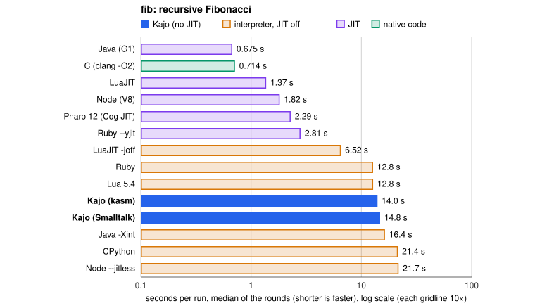
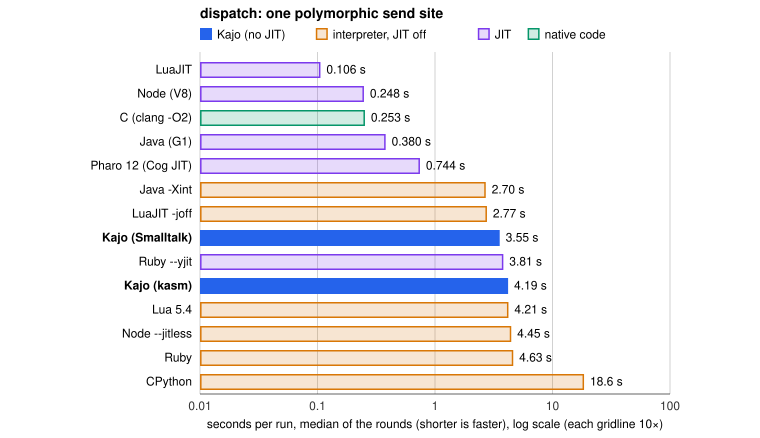
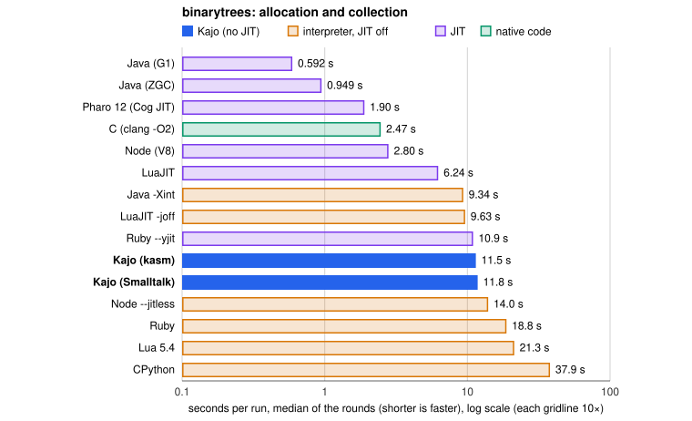
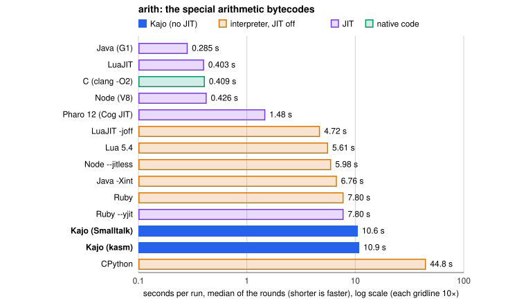
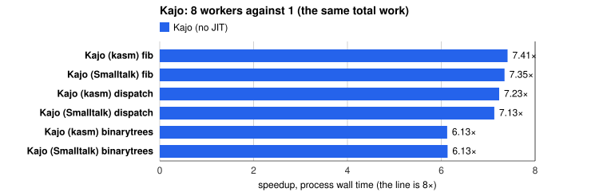

# Kajo's performance

How fast Kajo's interpreter and collector are against runtimes a reader
knows, measured on one machine on one day. The prose is written by hand; every
number, table and graph between `generated` markers is written by
`scripts/perf-report.py` from the raw files and is never edited by hand.

<!-- generated: meta -->
Measured 2026-11-07 12:03 EET at commit `a02c70b` on Apple M2 Pro, 8 P-cores + 4 E-cores, 32 GB, Mac14,12, macOS 27.2 (26B123); 5 interleaved rounds, every run bounded at 120 s; the time is the process's wall time.
<!-- /generated -->

## 0. What kind of VM this is

_Written by hand; see the module docs meanwhile._

## 1. How to read these numbers

Every runtime ran on the same machine on the same day, one program at a
time with nothing else of ours running. Each number is the median of five
rounds, and the rounds are interleaved: within a round every runtime runs the
kernel once before any runs it again, so a machine that warms up or slows
down over the session slows everyone alike; the first kernel is run once
more at the end to show how much it drifted. The time is the whole process's
wall time, start-up included for everyone, so the shortest runs are partly
start-up. Each program prints one checksum, and a run whose checksum differs
from the kernel's is refused and counts for nothing: every runtime in a table
did the same work, not merely a similar loop. Kajo is an interpreter with no
JIT, and it has to stay one, because iOS does not allow one; the runtimes
with a JIT are therefore also shown with it off (`luajit -joff`,
`node --jitless`, `java -Xint`, Ruby without `--yjit`), which is the
comparison with the most to say about Kajo's own design. C at `clang -O2` is
the floor. The parameters of every program and what each gap is made of are
in `experiments/runtime-comparison/RESULTS.md`.

## 2. Sends

<!-- generated: sends -->
**fib** (960 × fib(27 or 28), 798,757,440 calls per run)

| runtime | median s | min–max s | spread | time against Kajo (kasm) | M calls/s |
|---|--:|--:|--:|--:|--:|
| Java (G1) | 0.675 | 0.665–0.685 | 3.0% | 0.04× | 1183.9 |
| C (clang -O2) | 0.716 | 0.705–0.717 | 1.7% | 0.04× | 1115.7 |
| LuaJIT | 1.35 | 1.33–1.51 | 13.4% | 0.08× | 590.8 |
| Node (V8) | 1.83 | 1.82–1.83 | 0.5% | 0.11× | 437.2 |
| Pharo 12 (Cog JIT) | 2.30 | 2.30–2.31 | 0.5% | 0.14× | 346.8 |
| Ruby --yjit | 2.82 | 2.81–2.82 | 0.4% | 0.17× | 283.7 |
| LuaJIT -joff | 6.53 | 6.52–6.56 | 0.6% | 0.38× | 122.3 |
| Lua 5.4 | 12.8 | 12.8–12.8 | 0.2% | 0.75× | 62.4 |
| Ruby | 12.8 | 12.7–13.0 | 2.0% | 0.75× | 62.2 |
| Java -Xint | 16.4 | 16.4–16.5 | 0.7% | 0.97× | 48.7 |
| **Kajo (kasm)** | 17.0 | 17.0–17.0 | 0.1% | 1.00× | 47.0 |
| **Kajo (Smalltalk)** | 17.7 | 17.7–17.7 | 0.2% | 1.04× | 45.2 |
| CPython | 21.5 | 21.4–21.7 | 1.4% | 1.27× | 37.1 |
| Node --jitless | 21.8 | 21.7–21.9 | 0.9% | 1.28× | 36.7 |
| **Kajo (kasm), 8 workers (aggregate)** | 2.29 | 2.29–2.31 | 0.8% | 0.13× | 348.3 |
| **Kajo (Smalltalk), 8 workers (aggregate)** | 2.40 | 2.38–2.41 | 1.3% | 0.14× | 332.5 |

**dispatch** (100,000,000 sends over three classes plus an indexed read per run)

| runtime | median s | min–max s | spread | time against Kajo (kasm) | M sends/s |
|---|--:|--:|--:|--:|--:|
| LuaJIT | 0.106 | 0.102–0.111 | 8.2% | 0.02× | 947.0 |
| Node (V8) | 0.246 | 0.244–0.251 | 2.7% | 0.04× | 407.0 |
| C (clang -O2) | 0.251 | 0.248–0.257 | 3.5% | 0.04× | 397.8 |
| Java (G1) | 0.373 | 0.367–0.381 | 3.6% | 0.06× | 268.3 |
| Pharo 12 (Cog JIT) | 0.742 | 0.730–0.749 | 2.6% | 0.11× | 134.8 |
| Java -Xint | 2.72 | 2.68–2.73 | 2.1% | 0.41× | 36.8 |
| LuaJIT -joff | 2.84 | 2.81–2.84 | 1.2% | 0.43× | 35.2 |
| Ruby --yjit | 3.80 | 3.78–3.82 | 0.9% | 0.58× | 26.3 |
| Lua 5.4 | 4.23 | 4.11–4.23 | 3.0% | 0.64× | 23.7 |
| Node --jitless | 4.48 | 4.39–4.52 | 3.1% | 0.68× | 22.3 |
| Ruby | 4.63 | 4.62–4.69 | 1.4% | 0.71× | 21.6 |
| **Kajo (Smalltalk)** | 5.83 | 5.82–5.90 | 1.4% | 0.89× | 17.1 |
| **Kajo (kasm)** | 6.56 | 6.54–6.56 | 0.3% | 1.00× | 15.3 |
| CPython | 17.8 | 17.1–18.4 | 7.3% | 2.71× | 5.6 |
| **Kajo (Smalltalk), 8 workers (aggregate)** | 0.818 | 0.812–0.834 | 2.7% | 0.12× | 122.2 |
| **Kajo (kasm), 8 workers (aggregate)** | 0.906 | 0.899–0.913 | 1.6% | 0.14× | 110.4 |
<!-- /generated -->

## 3. Allocation and collection

<!-- generated: allocation -->
**binarytrees** (one long-lived tree of depth 12, then 1280 trees of depth 16 built, checked and dropped: 167,779,071 objects per run)

| runtime | median s | min–max s | spread | time against Kajo (kasm) | M objects/s |
|---|--:|--:|--:|--:|--:|
| Java (G1) | 0.593 | 0.591–0.604 | 2.2% | 0.05× | 283.0 |
| Java (ZGC) | 0.948 | 0.928–1.10 | 18.6% | 0.08× | 177.0 |
| Pharo 12 (Cog JIT) | 1.89 | 1.89–1.91 | 1.2% | 0.16× | 88.6 |
| C (clang -O2) | 2.46 | 2.45–2.47 | 1.0% | 0.21× | 68.2 |
| Node (V8) | 2.80 | 2.78–2.80 | 0.8% | 0.24× | 60.0 |
| LuaJIT | 6.23 | 6.15–6.27 | 1.8% | 0.53× | 26.9 |
| Java -Xint | 9.35 | 9.30–9.38 | 0.8% | 0.79× | 18.0 |
| LuaJIT -joff | 9.60 | 9.37–9.67 | 3.1% | 0.81× | 17.5 |
| Ruby --yjit | 10.6 | 10.5–10.9 | 4.5% | 0.90× | 15.8 |
| **Kajo (kasm)** | 11.8 | 11.8–11.8 | 0.2% | 1.00× | 14.2 |
| **Kajo (Smalltalk)** | 12.0 | 12.0–12.1 | 0.4% | 1.02× | 13.9 |
| Node --jitless | 14.0 | 14.0–14.1 | 0.9% | 1.19× | 12.0 |
| Ruby | 18.9 | 18.6–19.1 | 2.4% | 1.60× | 8.9 |
| Lua 5.4 | 21.3 | 21.1–21.6 | 2.2% | 1.81× | 7.9 |
| CPython | 38.0 | 37.9–38.1 | 0.5% | 3.22× | 4.4 |
| **Kajo (kasm), 8 workers (aggregate)** | 1.93 | 1.90–2.02 | 6.4% | 0.16× | 87.1 |
| **Kajo (Smalltalk), 8 workers (aggregate)** | 1.96 | 1.95–1.97 | 1.0% | 0.17× | 85.5 |

Collector pauses where the runtime reports them (medians over the rounds of each run's own percentiles; Kajo's pauses are its stops, its young collections on one worker run on the program's own thread; the JVM's from `-Xlog:gc`; Pharo reports only counts and totals):

| runtime | collections per run | pause p50 ms | pause p99 ms | pause max ms | Kajo's own young collections p50 / p99 ms |
|---|--:|--:|--:|--:|--:|
| Java (G1) | 12 pauses | 0.688 | 1.069 | 1.069 | - |
| Java (ZGC) | 15 pauses | 0.005 | 0.008 | 0.008 | - |
| Pharo 12 (Cog JIT) | 260 scavenges, 0 full (0 ms) | 0.688 (mean) | - | - | - |
| Java -Xint | 14 pauses | 0.603 | 0.957 | 0.957 | - |
| Kajo (kasm) | 1280 young, 36 stops | 0.087 | 0.332 | 0.332 | 1.639 / 1.905 |
| Kajo (Smalltalk) | 1280 young, 36 stops | 0.094 | 0.300 | 0.300 | 1.640 / 1.888 |
| Kajo (kasm), 8 workers (aggregate) | 1280 young, 31 stops | 0.215 | 29.571 | 29.571 | 2.149 / 4.397 |
| Kajo (Smalltalk), 8 workers (aggregate) | 1280 young, 31 stops | 0.228 | 19.261 | 19.261 | 2.157 / 4.416 |
<!-- /generated -->

## 4. Bytecodes

<!-- generated: bytecodes -->
**arith** (320,000,000 iterations of `sum := sum + (i * 3 + 7)`, a conditional subtract of 1000000007; in Kajo's kasm 7,334,400,000 bytecodes per run)

| runtime | median s | min–max s | spread | time against Kajo (kasm) | M iterations/s |
|---|--:|--:|--:|--:|--:|
| Java (G1) | 0.285 | 0.280–0.289 | 3.0% | 0.03× | 1124.0 |
| LuaJIT | 0.403 | 0.400–0.409 | 2.3% | 0.04× | 793.8 |
| C (clang -O2) | 0.409 | 0.399–0.419 | 4.9% | 0.04× | 781.8 |
| Node (V8) | 0.426 | 0.419–0.429 | 2.2% | 0.04× | 751.7 |
| Pharo 12 (Cog JIT) | 1.48 | 1.47–1.49 | 0.9% | 0.14× | 216.4 |
| LuaJIT -joff | 4.72 | 4.71–4.77 | 1.2% | 0.43× | 67.8 |
| Lua 5.4 | 5.61 | 5.59–5.66 | 1.2% | 0.52× | 57.0 |
| Node --jitless | 5.98 | 5.95–6.01 | 0.9% | 0.55× | 53.5 |
| Java -Xint | 6.76 | 6.75–6.77 | 0.3% | 0.62× | 47.4 |
| Ruby | 7.80 | 7.78–7.81 | 0.3% | 0.72× | 41.0 |
| Ruby --yjit | 7.80 | 7.79–7.82 | 0.3% | 0.72× | 41.0 |
| **Kajo (Smalltalk)** | 10.6 | 10.5–10.6 | 0.3% | 0.97× | 30.3 |
| **Kajo (kasm)** | 10.9 | 10.9–10.9 | 0.2% | 1.00× | 29.4 |
| CPython | 44.8 | 43.7–45.5 | 3.9% | 4.12× | 7.1 |

Kajo (kasm) runs 675 M bytecodes/s in its own kernel time (10.9 s of the 10.9 s process).
<!-- /generated -->

## 5. The Smalltalk library against Pharo

<!-- generated: library -->
**collections** (three times: an OrderedCollection of a million SmallIntegers filled and summed with `do:` and `inject:into:`; a Dictionary of 200 000 Symbol keys built and looked up; a String of a million characters built with a WriteStream and scanned; 500 000 SmallIntegers sorted; the same source in both)

| runtime | median s | min–max s | spread | time against Kajo (Smalltalk) |
|---|--:|--:|--:|--:|
| Pharo 12 (Cog JIT) | 1.64 | 1.62–1.65 | 1.7% | 0.23× |
| **Kajo (Smalltalk)** | 7.10 | 7.08–7.12 | 0.6% | 1.00× |
<!-- /generated -->

## 6. Scaling across workers

<!-- generated: scaling -->

| runtime | kernel | 1 worker s | 8 workers s | speedup |
|---|---|--:|--:|--:|
| Kajo (kasm) | fib | 17.0 | 2.29 | 7.41× |
| Kajo (Smalltalk) | fib | 17.7 | 2.40 | 7.35× |
| Kajo (kasm) | dispatch | 6.56 | 0.906 | 7.23× |
| Kajo (Smalltalk) | dispatch | 5.83 | 0.818 | 7.13× |
| Kajo (kasm) | binarytrees | 11.8 | 1.93 | 6.13× |
| Kajo (Smalltalk) | binarytrees | 12.0 | 1.96 | 6.13× |
<!-- /generated -->

The language experiment's Rust and Swift slices (`just bench`,
`experiments/vm-language-bench`), the evidence ADR 0001 rests on: the same
kasm kernels at their original sizes on a minimal VM, not Kajo's core.

<!-- generated: slices -->
From machine: Apple M2 Pro, 8 P-cores + 4 E-cores, no pinning.

| kernel | variant | 1 worker ms | 8 workers ms | speedup |
|---|---|--:|--:|--:|
| arith | rust | 3005.6 | 414.0 | 7.26× |
| arith | rust-native | 2993.4 | 415.2 | 7.21× |
| arith | swift-O | 3060.0 | 417.2 | 7.33× |
| arith | swift-Ounchecked | 3054.5 | 416.8 | 7.33× |
| arith | rust-align32 | 3009.1 | 415.4 | 7.24× |
| arith | swift-O-align32 | 3053.8 | 420.7 | 7.26× |
| fib | rust | 1463.1 | 208.5 | 7.02× |
| fib | rust-native | 1462.2 | 207.3 | 7.05× |
| fib | swift-O | 1543.2 | 215.3 | 7.17× |
| fib | swift-Ounchecked | 1538.4 | 213.3 | 7.21× |
| fib | rust-align32 | 1472.0 | 202.7 | 7.26× |
| fib | swift-O-align32 | 1542.7 | 216.1 | 7.14× |
| sends | rust | 2385.2 | 411.6 | 5.79× |
| sends | rust-native | 2389.4 | 408.1 | 5.85× |
| sends | swift-O | 2524.2 | 474.9 | 5.32× |
| sends | swift-Ounchecked | 2574.6 | 459.0 | 5.61× |
| sends | rust-align32 | 2391.1 | 443.9 | 5.39× |
| sends | swift-O-align32 | 2555.4 | 452.8 | 5.64× |
| alloc | rust | 2045.5 | 471.6 | 4.34× |
| alloc | rust-native | 2037.2 | 482.7 | 4.22× |
| alloc | swift-O | 2092.7 | 524.1 | 3.99× |
| alloc | swift-Ounchecked | 2122.1 | 518.6 | 4.09× |
| alloc | rust-align32 | 2038.3 | 486.4 | 4.19× |
| alloc | swift-O-align32 | 2100.0 | 498.0 | 4.22× |
<!-- /generated -->

## 7. On the devices

<!-- generated: devices -->
<!-- /generated -->

## 8. Caveats

<!-- generated: caveats -->
- Runtimes missing from this run: none.
- Thermal state at the runs' starts: nominal 341 runs.
- Refused runs: none; every run printed its kernel's checksum.
- Spread of the medians ((max − min) / median over each row's 5 rounds): at most 18.6% (Java (ZGC), binarytrees); 5 of 65 rows above 5%: Java (ZGC) binarytrees 18.6%, LuaJIT fib 13.4%, LuaJIT dispatch 8.2%, CPython dispatch 7.3%, Kajo (kasm), 8 workers (aggregate) binarytrees 6.4%.
- Drift: the first kernel (fib) run again at the end took 0.992 to 1.064 times its median (Ruby to LuaJIT).
- Every time is the whole process's wall time, start-up included for every runtime alike (Kajo loads its image or assembles its kasm, the JVM and Pharo start their VMs); a run of a few hundred milliseconds is mostly start-up.
<!-- /generated -->

## 9. Reproducing

`just perf` runs the comparison (`experiments/runtime-comparison/bench.sh`,
about 40 minutes), then `just bench` into
`experiments/runtime-comparison/slices-raw.txt` (the language experiment's
own raw file stays as published), then regenerates this file and its graphs;
`just perf-report` regenerates them from the raw files alone. The runtimes are
Homebrew's (`brew install lua luajit openjdk ruby`, Node from the machine's
own install) and Pharo 12 from its zeroconf download into
`experiments/runtime-comparison/pharo/`. Versions of this run:

<!-- generated: versions -->
| runtime | version |
|---|---|
| Kajo (kasm) | a02c70b release -enable-testing aligned, Swift 6.4.2 |
| Kajo (Smalltalk) | a02c70b release -enable-testing aligned, Swift 6.4.2 |
| Pharo 12 (Cog JIT) | Pharo12.0.0SNAPSHOT / v10.3.12+0.4b0622446 - Commit: 4b0622446 - Date: 2026-10-23 12:16:05 +0200 |
| C (clang -O2) | Apple clang version 21.0.0 (clang-2100.4.1.1), -O2 |
| LuaJIT | LuaJIT 2.1.1710088188 |
| LuaJIT -joff | LuaJIT 2.1.1710088188 |
| Lua 5.4 | Lua 5.4.6 |
| Node (V8) | Node v24.5.0 (V8 13.6.233.10-node.21) |
| Node --jitless | Node v24.5.0 (V8 13.6.233.10-node.21) |
| Java (G1) | OpenJDK Runtime Environment Homebrew (build 21.0.2) |
| Java -Xint | OpenJDK Runtime Environment Homebrew (build 21.0.2) |
| Java (ZGC) | OpenJDK Runtime Environment Homebrew (build 21.0.2) |
| Ruby | ruby 3.3.0 |
| Ruby --yjit | ruby 3.3.0 |
| CPython | Python 3.12.2 |

Raw files: `experiments/runtime-comparison/bench-raw.txt` (5 rounds) and `experiments/runtime-comparison/slices-raw.txt`.
<!-- /generated -->
